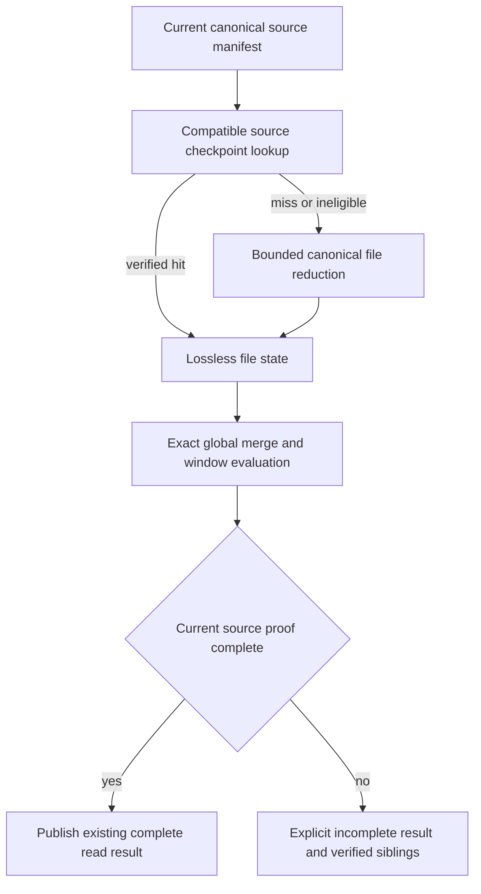

# Logical Components: Verified Dashboard Checkpoints

| Component | Responsibility |
|---|---|
| Existing dashboard data service | One worker/admission owner; 16 MiB RAM cache, freshness, sibling availability and source-root limits remain. Direct test instances do not write disk unless explicitly given an isolated store. |
| Canonical manifest | Existing source selection and complete live file/member proof, captured after optional namespace preparation; no cache-only source discovery. |
| Per-kind file reducer/codec | Lossless unfinalized activity, single-file per-account snapshots and proposal state; explicit dynamic/nonfinite/unsupported exclusions. No universal float/curve merge. |
| Checkpoint store | One global 64 MiB private namespace on the existing data volume, bounded packs/index, integrity/owner checks, nonblocking locking, atomic publish and owned-only cleanup. |
| Merge coordinator | Current source-local ordinal rebasing, raw cycle/global companion join, window expiry and ordered consumer semantics, all under original active-state limits. |
| Published read result | Existing complete/fresh/stale/pending/unavailable contract. Current canonical proof and evaluation are required; disk bytes never directly become a fresh report. |
| Runtime safety reader | Separate approved-design candidate. It does not trust dashboard cached counters or use this store to make risk decisions in this first slice. |

## Proposed implementation sequence after approval

1. Add eligibility/versioned kind codecs and independent merge-oracle tests before
   storage integration. Keep ledger float and hierarchical curve fallbacks explicit.
2. Add private bounded pack/index store and fault-injection tests using isolated
   directories; no production namespace creation during tests/design.
3. Integrate the existing worker with namespace-before-manifest ordering, one
   global accounting model and optional cache misses. No per-page executor.
4. Verify full dataset outputs, source mutation, dynamic/default/nonfinite cases,
   original policy freshness and both roots/session budgets; full pytest/format/mypy.
5. Measure all cold/restart/changed-source/failure/native/guest scenarios honestly,
   then scoped exact-source same-capacity deployment and post-rollout qualification.

Likely source owners: dashboard projections/sources/data service, a dashboard-owned
checkpoint module, optional settings/factory wiring, corresponding tests and
qualification scripts. Keep filesystem primitives neutral if shared; do not add a
runtime-to-dashboard dependency or a generic database/object serialization layer.
No planned file is modified by this design artifact.
