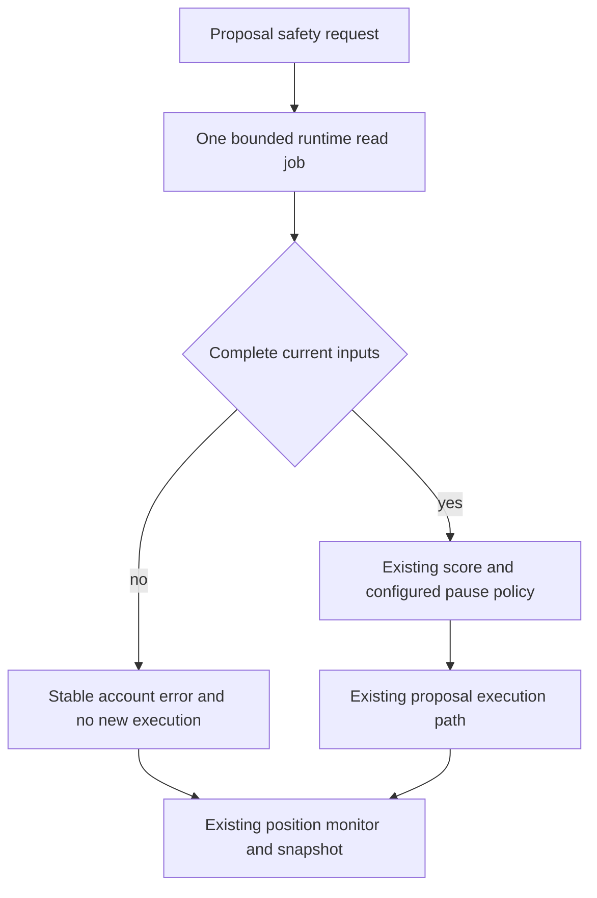

# Logical Components: Streaming Runtime Safety

| Component | Owner / responsibility |
|---|---|
| Runtime safety facade | Engine captures UTC/monotonic identity, preserves `None` cache distinction, charges extras/cycle work and awaits one process-owned job. |
| Safety read service | One lazy daemon worker, no waiting backlog; quarantines busy IO, discards late/cancelled results, exposes stable failures. Never owns exchange, trader or notification actions. |
| Bounded activity source | Runtime/persistence layer selects the exact retained source set, validates file versions/readability, streams UTF-8 records under the legacy runtime parse policy, closes all handles. No dependency on dashboard modules. |
| File validation summary | Optional in-memory negative cache for fully validated unchanged old files, with timestamp-default flag and version/readability proof; not persisted and not a score. |
| Safety accumulator | One-shot exact counters and live-condition set; same fixed-time semantics and bounded state, no rich event list/sort. |
| Failure isolation adapter | Engine catches only typed safety-read failures before execution, records a sanitized error, stops remaining risk proposals for that account and preserves monitor/snapshot. Ordinary guard remains. |
| Shared verification | Unit oracle, one-shot/lifetime/FD checks, paper/live pause behavior and actual resource/page/health/engine qualification. |

## Proposed source/test sequence after approval

1. Add neutral bounded forward row/context support without changing dashboard
   strict policy or legacy chronological APIs. Verify old/source-order compatibility.
2. Refactor pure safety helpers for one-shot inputs, retaining fixed-time formula
   behavior; keep list-returning public helpers where callers expect them.
3. Add runtime-owned worker/budgets/negative metadata cache; no dashboard import.
4. Integrate both engine call sites and typed failure isolation, cycle budgets
   and lifecycle. Keep live defaults/thresholds unchanged.
5. Run reader/safety/engine/config/main/notification/dashboard tests, full pytest,
   Black/Ruff/mypy and independent numerical oracle/resource benchmarks.
6. Build a minimal exact-dependency overlay and perform same-capacity rollout;
   verify every runtime input, modes, cycle and actual server/native evidence.

Likely application owners: `src/utils/bounded_read.py`,
`src/runtime/jsonl_rotator.py`, `src/runtime/activity_log.py`,
`src/runtime/safety_score.py`, a runtime-owned reader module, `src/runtime/engine.py`
and existing shutdown wiring only if needed. Tests belong to the corresponding
reader, rotator, activity, safety, engine and main/notification suites.

These are planned files, not changed source. Error-path workflow changes are
explicitly isolated in the Functional amendment; approval is not inferred from
this file or a test/deploy tool permission.
